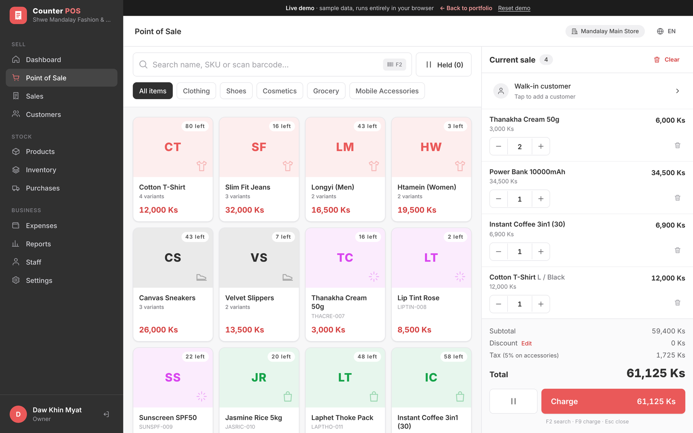

# Counter POS — Live Demo

An interactive front-end demo of **Counter POS**, a retail point-of-sale SaaS for small and medium shops in Myanmar (clothing, shoes, cosmetics, mini-markets, mobile accessories).

Designed and built by **[Kaung Htet San](https://kaunghtetsan.online)**.



> The production app is built with Laravel, Tailwind CSS and Alpine.js. This repository is a **static showcase**: the same design rebuilt in plain HTML, CSS and JavaScript so it can run on GitHub Pages with no server. All data is sample data that lives only in the visitor's browser.

## What you can try

| Screen | What works |
|---|---|
| **Sign in** | Pick Owner, Manager or Cashier — each role sees different menus |
| **Point of Sale** | Search by name / SKU / barcode, category tabs, variant picker, quantity stepper, line & order discounts, customer picker with quick-add, hold & resume carts, cash / mobile pay / card / bank transfer, split payments, change calculation, 58 mm / 80 mm / A4 receipt preview and print |
| **Dashboard** | Today / 7 days / 30 days, net sales, profit, low-stock alert, sales chart, payment methods, best sellers |
| **Sales** | Search & filter receipts, sale detail, refund, reprint |
| **Products** | Category filter, margins, add a new product (shows up in the POS) |
| **Inventory** | Stock value, low / out-of-stock, stock adjustments |
| **Customers, Purchases, Expenses, Reports, Staff, Settings** | Sample data and layouts |

Keyboard on the POS: **F2** search · **F9** charge · **Enter** scan/add · **Esc** close.

Sales you make and stock changes are saved in `localStorage`; **Reset demo** in the top bar clears them.

## No CDN, no build step

- No frameworks, no external scripts, stylesheets or fonts — everything is in this repo.
- The Inter font is bundled in `assets/fonts/`; icons are inline SVG.
- Works by opening `index.html`, or from any static host.

```
index.html          app shell
css/app.css         design tokens + all components
js/data.js          sample catalogue, customers, 30 days of sales
js/app.js           router, screens, checkout logic
assets/             favicon, font
docs/               design board + cover image for the portfolio
```

## Deploy on GitHub Pages

1. Create a new **public** repository on GitHub, e.g. `counter-pos-demo`.
2. Upload the files (keep the folder structure):

   ```bash
   cd counter-pos-demo
   git init
   git add .
   git commit -m "Counter POS live demo"
   git branch -M main
   git remote add origin https://github.com/<your-username>/counter-pos-demo.git
   git push -u origin main
   ```

   Or on github.com: **Add file → Upload files**, drag in everything inside this folder, then **Commit changes**.
3. In the repository go to **Settings → Pages**. Under *Build and deployment* choose **Deploy from a branch**, branch **main**, folder **/ (root)**, then **Save**.
4. After a minute the demo is live at `https://<your-username>.github.io/counter-pos-demo/`.

### Use your own sub-domain (optional)

To serve it at e.g. `pos-demo.kaunghtetsan.online`:

1. At your DNS provider add a **CNAME** record: name `pos-demo`, value `<your-username>.github.io`.
2. In **Settings → Pages → Custom domain** enter `pos-demo.kaunghtetsan.online`, save, then tick **Enforce HTTPS** once it is available.

## Add it to the portfolio

Link the project card on kaunghtetsan.online to the GitHub Pages URL, and use `docs/cover.png` as the card image and `docs/design-board.png` for the case-study page. The demo can also be embedded:

```html
<iframe src="https://<your-username>.github.io/counter-pos-demo/" width="100%" height="800"
        style="border:0;border-radius:12px" title="Counter POS live demo" loading="lazy"></iframe>
```

The **Back to portfolio** link in the demo points to `https://kaunghtetsan.online` (change `PORTFOLIO_URL` at the top of `js/app.js` if needed).

## Credits

- Typeface: [Inter](https://rsms.me/inter/) by Rasmus Andersson, SIL Open Font License.
